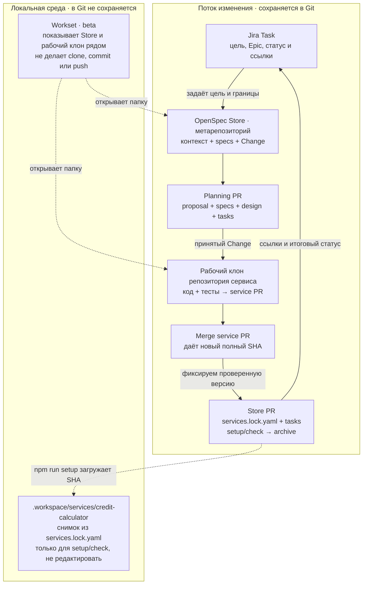

# Как связаны OpenSpec Store, Workset и репозиторий сервиса

## Где хранятся требования и код

Метарепозиторий — канонический OpenSpec Store. В нём хранятся `CONTEXT.md`,
продуктовые границы, `openspec/specs/` и `openspec/changes/`. Репозиторий
сервиса хранит код и тесты.

Store использует встроенную схему
[`spec-driven`](https://openspec.dev/docs/schemas/spec-driven). Proposal
называет мотив, изменение, затронутые capabilities и impact; specs фиксируют
поведение, design — только нужные решения, tasks — последовательность работы.
Для изменения требования существующей возможности указывается её точный путь в
`Modified Capabilities`, а не создаётся новая capability.

## Как проходит изменение

Один Change описывает ожидаемое поведение. Реализация проходит отдельным PR в
сервисном репозитории, затем Store фиксирует проверенную версию сервиса.



| Элемент | Что это | Зачем нужен |
| --- | --- | --- |
| Jira Task | Карточка учебной работы | Хранит цель, связь с Epic, статус и ссылки, но не дублирует спецификацию. |
| OpenSpec Store | Метарепозиторий контекста, specs и Changes | Даёт один канонический план изменения. |
| `proposal.md` | Обоснование и границы Change | Объясняет аналитику, зачем нужно изменение и какая capability меняется. |
| Delta spec | Изменение наблюдаемого поведения | Фиксирует требования и проверяемые сценарии без описания реализации. |
| `design.md` | Нужные технические решения | Связывает требования с границами сервиса без лишней архитектуры. |
| `tasks.md` | Проверяемая последовательность реализации | Показывает, что сделать и как подтвердить результат. |
| Workset | Локальный список папок Store и сервиса | Показывает план рядом с кодом, не объединяя Git-истории. |
| Репозиторий сервиса | Отдельный Git-репозиторий кода и тестов | Здесь выполняется Apply и создаётся service PR. |
| `services.lock.yaml` | Ссылка на точный SHA сервиса после merge | Делает итоговую проверку воспроизводимой. |
| `.workspace/services/credit-calculator/` | Автоматически загруженный проверочный снимок | Нужен для анализа и setup/check; вручную не редактируется. |

`.workspace/services/credit-calculator/` — не рабочая директория, а чистый
checkout закреплённого SHA для воспроизводимой проверки. Его нельзя включать в
Workset как writable member и нельзя менять вручную.

## Что сохраняется локально

Store имеет проверяемую identity в `.openspec-store/store.yaml` и живёт в Git:
его изменения коммитятся, пушатся и ревьюятся как обычный репозиторий.

Workset сохраняется только на машине разработчика. Он объединяет Store и
рабочий клон сервиса в одном окне редактора; ни в один из репозиториев запись о
Workset не попадает. Обе папки становятся видны рядом, но агент читает только
явно указанные файлы. Git-истории остаются независимыми.

## Необязательный Workset после принятия Change

После успешного `setup-analysis-workspace` Store уже зарегистрирован. Когда
Change принят и нужен код, поместите рабочий клон сервиса рядом и создайте
локальный Workset:

```bash
git clone https://github.com/apolenkov/sdd-guide-credit-calculator-stage-3.git \
  ../sdd-credit-calculator-example
npm exec openspec -- workset create credit-calculator \
  --member service=../sdd-credit-calculator-example \
  --member meta-store=. \
  --tool code
npm exec openspec -- workset open credit-calculator
```

Если клон сервиса уже существует, первую команду пропустите. Если Workset не
создаётся, проверьте Store командой
`npm exec openspec -- store doctor sdd-credit-calculator-product-meta --json`.

OpenSpec 1.12 открывает Workset в VS Code или Cursor, но не запускает OpenCode
как opener:

1. Для планирования запустите OpenCode из корня Store.
2. Для Apply откройте Workset и запустите OpenCode в терминале участника
   `service`.

Корневой `openspec/config.yaml` сервиса разрешает тот же Store, а Store-aware
skills находятся в `.opencode/skills/` обоих репозиториев.

В Store выполняются `propose`, проверка и учёт задач Change. В Workset агент
читает Change из Store, а код и тесты меняет только в service clone. После
реализации создаётся service PR. После его merge новый полный SHA переносится в
`services.lock.yaml` отдельным Store PR; проверка выполняется из свежего клона
Store командами `npm run setup` и `npm run check`, затем Change архивируется.

## Почему beta и что не обещаем

Store и Workset — beta-возможности OpenSpec 1.12. OpenSpec не выполняет Git
clone/pull/push и не гарантирует синхронность checkout-ов. Поэтому remote,
ветка, merge и обновление lock-файла остаются явными шагами процесса.

Это не второй источник требований: Jira хранит ссылку и статус, Store —
спецификацию и Change, сервис — реализацию и тесты, lock — точный проверенный
снимок сервиса.

Официальные ссылки: [Stores](https://openspec.dev/docs/stores) и
[Worksets](https://openspec.dev/docs/worksets).
