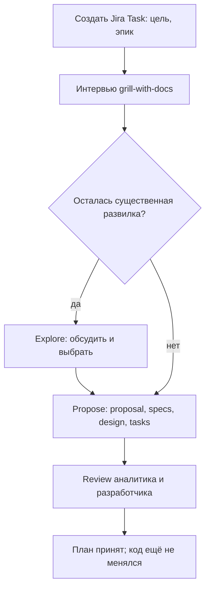
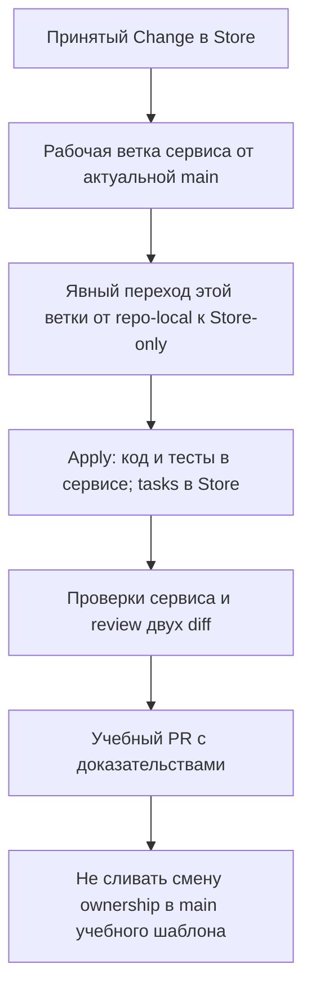

# Как связаны учебные репозитории, OpenSpec Store и реализация

## Четыре репозитория, четыре учебные задачи

| Ступень | Репозиторий | Источник требований | Результат |
| --- | --- | --- | --- |
| 1 и 1-ИИ | sdd-credit-calculator-stage-1-example | specification.md | Уточнённое правило и сценарий в своей ветке |
| 2 и 2-ИИ | sdd-credit-calculator-stage-2-example | specification.md | Изменение с двумя человеческими review |
| 3 и 3-ИИ | sdd-credit-calculator-example | openspec/specs в корне | Проверенная связь требований, кода и тестов |
| 3★ | sdd-credit-calculator-product-meta-example | openspec/specs в Store | Проверенный Change до реализации |

Это самостоятельные учебные примеры. Не переносите файлы между ступенями ради одинакового текста. ИИ-дополнение работает в том же репозитории, что и базовая ступень.

Метарепозиторий — канонический OpenSpec Store для упражнения 3★, а не глобальный владелец всех учебных снимков.

## Обязательный путь аналитика



Jira хранит цель, статус и ссылки. Итоги интервью уточняются в сессии и затем входят в Change; отдельный обязательный комментарий с копией требований не нужен.

Store использует стандартную схему [spec-driven](https://openspec.dev/docs/schemas/spec-driven):

| Артефакт | На какой вопрос отвечает |
| --- | --- |
| proposal.md | Зачем изменение и что входит в него? |
| delta specs | Как изменяется наблюдаемое поведение? |
| design.md | Какие решения нужны для реализации? |
| tasks.md | Что сделать и как проверить каждую задачу? |

Изменяемую возможность указывают по существующему пути в Modified Capabilities. Не создавайте новую capability вместо изменения существующей. Для изменения без продуктовых требований используется skip_specs, а не придуманное требование.

## Локальная подготовка

npm ci устанавливает инструменты Store. npm run setup проверяет среду и содержимое Store, не загружая сервис и не меняя реестр OpenSpec.

Необязательный npm run bootstrap получает исходники по services.lock.yaml для чтения. .workspace/services/credit-calculator — не рабочая директория реализации. Проверки Store не подтверждают тесты или работоспособность сервиса.

Store identity хранится в .openspec-store/store.yaml и входит в Git. Регистрация связывает этот ID с физическим checkout на конкретном компьютере. Она нужна, когда вы обращаетесь к Store по ID из другого репозитория; clone сам по себе не переносит регистрацию.

## Необязательное продолжение: реализация

Начинайте только после принятия Change людьми. Требуется отдельный рабочий клон сервиса, а не .workspace.



### Подготовьте две рабочие ветки

Из чистого корня метарепозитория после принятия planning PR:

```bash
git switch main
git pull --ff-only
git switch -c feature/limit-credit-amount-delivery
```

Если сервиса рядом ещё нет:

```bash
git clone https://github.com/apolenkov/sdd-guide-credit-calculator-stage-3.git ../sdd-credit-calculator-example
```

В чистом клоне сервиса:

```bash
cd ../sdd-credit-calculator-example
git switch main
git pull --ff-only
git switch -c feature/limit-credit-amount
npm ci
```

Не повторяйте создание существующей ветки и не сбрасывайте локальные изменения.

### Зарегистрируйте выбранный Store

Из корня метарепозитория сначала проверьте:

```bash
npm exec openspec -- store list --json
```

Если ID sdd-credit-calculator-product-meta отсутствует:

```bash
npm exec openspec -- store register .
```

Если ID уже указывает на этот checkout, ничего не меняйте. Если указан другой путь, остановитесь и выберите рабочий checkout вместе с владельцем среды. Не разрегистрируйте чужой Store автоматически.

Проверьте результат:

```bash
npm exec openspec -- store doctor sdd-credit-calculator-product-meta
```

### Переведите только учебную рабочую ветку в Store-only

Из корня сервиса откройте OpenCode и отправьте:

```text
Подготовь переход только текущей ветки feature/limit-credit-amount
к Store sdd-credit-calculator-product-meta.
Сначала сравни локальные specs и историю Changes с этим Store.
Покажи, какие требования и история уже сохранены, чего не хватает
и где есть противоречия. Ничего пока не удаляй и не перезаписывай.
Код не реализуй. Общая main должна остаться repo-local шаблоном.
```

Проверьте сопоставление. Если есть противоречия, сначала примите содержательное решение. Когда сохранность подтверждена, отправьте:

```text
Выполни согласованный перенос требований и истории в Store
без перезаписи существующих Changes. Удали из рабочей ветки сервиса
только те локальные specs и changes, сохранность которых подтверждена.
В openspec/config.yaml настрой store: sdd-credit-calculator-product-meta.
Обнови README.md и AGENTS.md этой рабочей ветки: владельцем specs и Changes
теперь является Store, а код и тесты остаются в сервисе. Убери инструкции,
которые требуют редактировать уже перенесённые локальные specs и changes.
Проверь разрешение Store штатным OpenSpec doctor и запусти npm run check
в сервисе. Проверка должна читать требования из Store и проверять код сервиса.
Покажи diff отдельно для Store и сервиса. Реализацию пока не начинай.
```

Не поддерживайте локальные specs и Store как две редактируемые копии одного контракта. Store-only означает одного владельца требований, а не постоянное сравнение двух файлов.

### Реализуйте и проверьте

В той же сессии сервиса отправьте:

```text
Используй OpenSpec Apply для Change limit-credit-amount
в Store sdd-credit-calculator-product-meta.
Реализуй только принятые требования в текущем сервисном клоне.
Код и тесты меняй в сервисе; выполненные tasks отмечай в Store
только после проверки. Не меняй .workspace.
Запусти проверки сервиса и проверь все сценарии Change.
Представь результаты и два diff для review.
Не выполняй merge, не обновляй services.lock.yaml и не архивируй Change.
```

Проверьте требования, тесты, интерфейс и оба diff. Укажите непройденные проверки, а не заменяйте их зелёным check Store.

Учебный PR, переводящий шаблон в Store-only, не сливается в общую main: иначе следующий ученик потеряет самостоятельную ступень 3. Код, тесты и результаты можно предъявить в этой ветке. Для постоянного Store-only сервиса нужен отдельный репозиторий или согласованная миграция продукта, вне текущего упражнения.

В обычном продуктовом процессе после merge сервиса фиксируют проверенный SHA в services.lock.yaml, подтверждают реализацию, синхронизируют требования и архивируют Change. Не выдавайте этот промышленный финал за выполненный в учебной ветке.

## Workset — необязательный список папок

[Workset](https://openspec.dev/docs/worksets) позволяет открыть Store и рабочий клон рядом в поддерживаемом редакторе. Он не выполняет clone, commit, push или merge и не объединяет Git-истории.

OpenCode можно запускать напрямую из нужного корня. Его маршрут не зависит от Workset; не устанавливайте другой редактор только ради упражнения.

[Store](https://openspec.dev/docs/stores) и Workset — beta-возможности OpenSpec. Версия инструмента закреплена в зависимостях репозитория; проверяйте команды этой версии, а не случайную инструкцию для другой.
