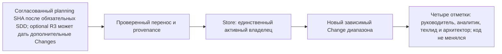

# Как связаны ступени 3, Store и реализация

## Накопительный контракт

| Артефакт | Активный владелец на ступени 4 | Статус |
| --- | --- | --- |
| Весь импортированный `openspec/specs/` | product-meta Store | фактический baseline источника; может не содержать предметной spec |
| Каждый Change из planning manifest | product-meta Store | унаследованный активный Change, implementation tasks `- [ ]` |
| `limit-credit-amount` | product-meta Store | новый зависимый Change, tasks `- [ ]` |
| Код и runtime-тесты | отдельный checkout сервиса | не меняются в аналитической ступени |
| `.workspace/services/credit-calculator` | meta, только read-only контекст | не место разработки |

Полный курс проходит обязательные SDD и OpenSpec, после чего организатор R4 импортирует весь `openspec/specs/` и **все** активные Changes из конкретного согласованного planning SHA в Store. Факультативная R3 может добавить свои Changes в тот же источник. Store становится единственным активным владельцем переданных planning-артефактов.



## Подготовленный путь аналитика

Организатор готовит, дважды проверяет и публикует personal import-base по [отдельной инструкции](../organizer-stage-4.md). Аналитик создаёт fork с копированием всех веток, клонирует опубликованную ветку из своего fork в каноническую папку и работает из VS Code с агентом Kilo:

```bash
git clone --branch course/<LOGIN>/stage-4-import-base --single-branch \
  <FORK_REPOSITORY_URL> sdd-guide-credit-calculator-stage-4-requirements
cd sdd-guide-credit-calculator-stage-4-requirements
```

В чате агента Kilo ученик явно вызывает `setup-analysis-workspace`;
навыки OpenSpec лежат в универсальном `.agents/skills` и читаются Kilo
автоматически. Skill проверяет
requirements base/SHA, выполняет setup, создаёт либо проверяет соседний code
checkout на точном service pin, запускает `check:code`, связывает Store, два
реальных bootstrap и `check:store`. При конфликтующем Store root или существующем
code checkout с другим origin/HEAD/status он останавливается без автоматической
замены. Затем выполняются original MTP `grill-with-docs`, Explore при существенной
развилке и Propose. Для текущего R4 diff нужны отметки руководителя проекта,
аналитика, технического руководителя и архитектора: изменение затрагивает связь
с системой банка. Apply запускается отдельно только после принятия зависимого
договора и нового разрешения на реализацию.

## Явное разрешение Store

Store identity хранится в `.openspec-store/store.yaml`. Регистрация — локальная связь ID с физическим checkout. Она не переносится через Git и не даёт доступа к чужой папке.

Каждая команда чтения унаследованного и нового Changes использует:

```bash
--store sdd-credit-calculator-product-meta
```

Перед работой проверяются `store list --json` и `store doctor ... --json`. Если ID указывает на другой root, skill показывает точные старый и новый пути и останавливается; переключение возможно только после отдельного подтверждения и повторной проверки состояния. Временные acceptance-checkout используют отдельный `XDG_DATA_HOME`.

## Готовый репозиторий кода R4

Будущий разработчик работает с двумя соседними папками:

```text
work/
  sdd-guide-credit-calculator-stage-4-requirements/  # specs, Changes, tasks
  sdd-guide-credit-calculator-stage-4-code/          # src и runtime-тесты
```

Полный setup заранее создаёт новый code checkout в detached HEAD на SHA из
`services.lock.yaml`, но не разрешает разработку. После принятия полного
фактического набора Changes и отдельного разрешения разработчик проверяет этот
checkout и только тогда создаёт личную ветку. В новом комплекте:

1. местных `openspec/specs` и `openspec/changes` в сервисе уже нет; переносить или удалять старые требования не нужно;
2. `openspec/config.yaml` уже содержит `store: sdd-credit-calculator-product-meta`;
3. `npm exec openspec -- list --json` без `--store` подтверждает `root.source: declared`, нужную папку product-meta и фактический набор Changes;
4. код и тесты меняются только в сервисном checkout; tasks — только в Store.

Общая `main` R3 остаётся repo-local и не меняется. Уже существующие личные пары и service pins не заменяются автоматически. Нельзя поддерживать Store и местные папки как два редактируемых контракта или использовать `.workspace` для реализации. Перед работой агенту явно разрешают доступ к обоим root и задают границы правок; указатель Store сам этих прав не даёт.

## Порядок реализации

После отдельного разрешения разработчик определяет порядок реализации по явным зависимостям всех импортированных Changes и `limit-credit-amount`. Для каждого Change сначала читаются `status` и `instructions apply`, после проверки отмечаются только реально выполненные tasks.

Полные команды и сообщения находятся в [`docs/developer-handoff.md` сервиса R4](https://github.com/apolenkov/sdd-guide-credit-calculator-stage-4-code/blob/main/docs/developer-handoff.md). Commit, push, merge, обновление `services.lock.yaml` и архивирование Changes не выполняются Store или Workset автоматически.

Workset остаётся необязательным списком папок; он не клонирует Git и не объединяет артефакты разных Changes.
