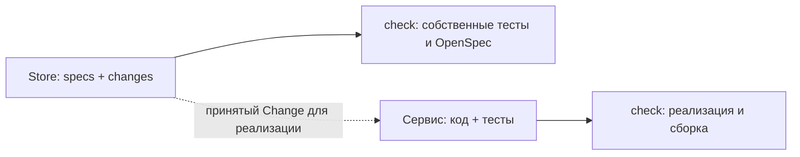
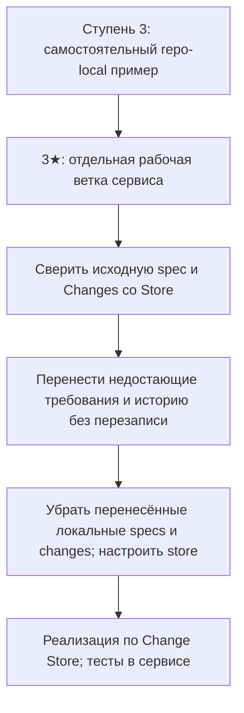

## Context

Причина изменения описана в proposal.md. Целевая учебная структура содержит четыре репозитория: Markdown, Markdown с review, приложение с repo-local OpenSpec и метарепозиторий Store. ИИ-дополнения используют те же файлы, а не отдельные реализации.

Store хранит требования и Changes; Workset хранит список папок, но не управляет Git. Основание: [Stores](https://openspec.dev/docs/stores), [Worksets](https://openspec.dev/docs/worksets), [spec-driven](https://openspec.dev/docs/schemas/spec-driven).

## Goals / Non-Goals

**Goals:**
- Обычные проверки Store работают без сервисного checkout.
- У каждого упражнения один явный владелец требований.
- Учебные шаги не требуют ручной синхронизации одинаковых документов.

**Non-Goals:**
- Запускать сервис или его тесты из Store.
- Сравнивать независимые учебные спецификации на полное текстовое равенство.
- Автоматически менять регистрацию Store, Git-ветки или удалённые репозитории.
- Превращать общую main ступени 3 в Store-only.

## Decisions

### 1. Проверки разделены по владельцам

Store проверяет свои документы, структуру, provenance skills и отсутствие публикуемых секретов. Сервис проверяет реализацию. Зелёная проверка Store не доказывает работоспособность сервиса.

setup выполняет doctor и check; установку зависимостей самого Store выполняют один раз через npm ci. Получение исходников сервиса остаётся отдельным необязательным bootstrap для интервью, а не условием начала упражнения.

### 2. Snapshot — контекст анализа, не вторая спецификация

services.lock.yaml фиксирует проверенную версию исходников для воспроизводимого чтения. Этот SHA не берут из Jira и не требуют от ученика выбирать вручную. Bootstrap получает только исходники, не устанавливает зависимости сервиса и не запускает его.

Для существующего snapshot проверяются origin, SHA и чистота. Несоответствие останавливает операцию; чужие правки не сбрасываются. Текстовое сравнение specs и отдельный contract:check не вводятся: они закрепляли бы ненужные копии требований.

Рабочую ветку реализации создают от актуальной main, затем сверяют изменения с контекстом анализа. Snapshot не служит местом реализации.

### 3. Переход к Store выполняется явно

До удаления локальных материалов проверяют, что их требования и история сохранены. При конфликте требуется содержательное решение, а не замена файлов. После перехода корневой config сервиса указывает Store; локальные specs и changes не поддерживаются параллельно.

Это переход рабочей ветки упражнения, а не миграция общей main шаблона. Итоги учебной реализации предъявляют в MR без слияния, если MR переводит шаблон в Store-only. Общая ступень 3 должна остаться доступна следующему ученику. Для постоянного промышленного Store-only сервиса потребовалось бы отдельное решение вне модели четырёх учебных репозиториев.

Регистрация Store нужна при обращении к нему из другого репозитория. Конфликт ID показывает оба пути и не меняет регистрацию автоматически. Временные проверки используют изолированный XDG_DATA_HOME. Workset необязателен; OpenCode не требует поддерживаемого редактором Workset opener.

### 4. Уточнение текущей спецификации

Принятый delta применяется стандартной синхронизацией OpenSpec. Сохраняются исходные сценарии и история; заголовок и Purpose редактируются только по смыслу, не ради равенства с другим файлом. В этом Change не вводится диапазон 10 000–100 000 000: он остаётся заданием ученика.

### 5. Удаление обвязки

Удаляются запуск сервиса, HTTP acceptance, отдельный setup orchestrator, npm runtime helper и дублирующая structural validation. Нужные инварианты переходят в собственные meta-тесты, а безопасное получение snapshot проверяется изолированными Git fixtures.

Сохраняются generated OpenSpec skills, оригинальные MTP-зависимости, provenance и архив. Критерий упрощения — отсутствие дублирующих обязанностей, а не заранее заданное количество файлов.

README содержит линейные шаги и полные сообщения; CONTRIBUTING — сопровождение; AGENTS — границы работы; архитектурный документ — связи и схемы.

## Risks / Trade-offs

- Проверки Store не подтверждают сервис → результаты сервисных тестов предъявляются отдельно.
- Рабочая ветка Store-only может сломать учебный шаблон при merge → запрет такого merge указан в README и критериях review.
- Исходники недоступны по сети → анализ кода не считается выполненным; подготовка Store остаётся доступной.
- Уже зарегистрирован другой checkout → остановка перед изменением реестра.
- Внешние runner и публикация недоступны → локальные доказательства явно отделяются от внешних.

## Migration Plan

1. Синхронизировать принятый delta и проверить strict validation.
2. Упростить Store-команды и доказать check без snapshot.
3. Убрать service dependency install из bootstrap; проверить Git guards на временных fixtures.
4. Обновить документацию, setup skill и маршрут перехода к Store-only.
5. Пройти проверки из чистого локального клона с изолированным реестром.
6. Архивировать только после выполнения задач; откат локальных изменений — через Git, без автоматического изменения внешних данных.
